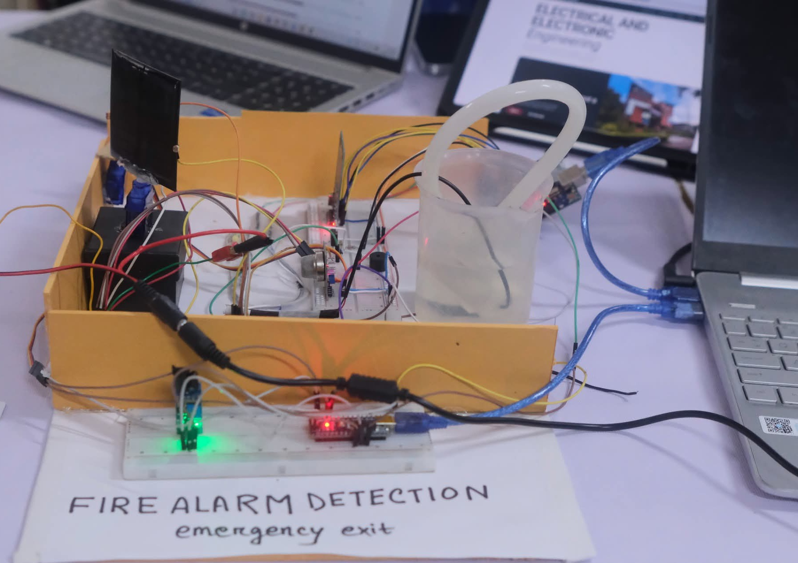
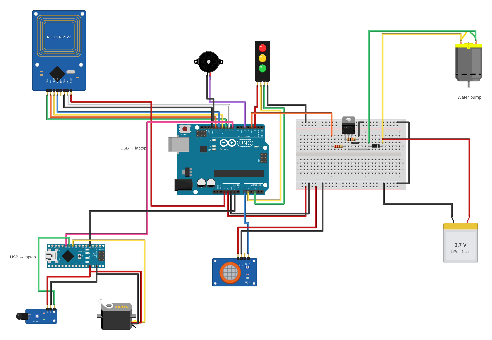
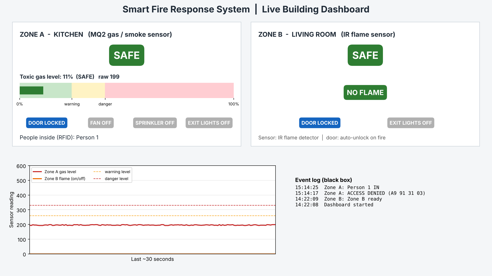
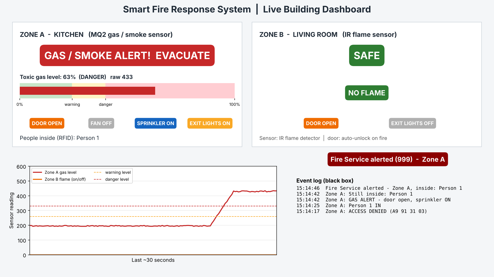

# প্রহরী

### Smart Fire & Gas Leak Response System

*প্রহরী (Prohori) is Bangla for "guard" or "watchman".*

A working model of a building that keeps watch for gas leaks and fire, and responds on its own. It sounds the alarm, opens the exit door, runs a sprinkler, lights the way out, and reports who is still inside.

## Why

> [!IMPORTANT]
> **People are rarely trapped just because a door is locked. They are trapped because nobody noticed the danger fast enough to open it.**
>
> Prohori is the watchman that notices first and opens the way out, so nobody inside has to wait for someone else to realise what is happening.

## What it does

| Situation | Detected by | Response |
|---|---|---|
| Normal | – | Door locked. Opens for 3 s for a registered RFID card, which marks that person as inside or outside |
| Unknown card | RC522 RFID reader | Door stays locked; "ACCESS DENIED" is logged |
| Gas or smoke | MQ-2 sensor (reading above 330) | Buzzer, water-pump sprinkler, exit arrows (red → yellow → green), door opens, list of people inside is reported |
| Fire | IR flame sensor | Door opens; alarm held for 2 s after the flame disappears |

The system has two zones:

- **Zone A, kitchen (Arduino Uno):** MQ-2 gas sensor, RFID door, buzzer, pump sprinkler, exit LEDs
- **Zone B, living room (Arduino Nano):** IR flame sensor, door servo

The Uno tells the Nano to open the door through a single signal wire (D8 → D8).

## Hardware

Arduino Uno, Arduino Nano, MQ-2 gas sensor module, IR flame sensor module, RC522 RFID reader, servo motor, buzzer, small DC water pump, IRFZ44N MOSFET with 220 Ω and 10 kΩ resistors, flyback diode, 3.7 V single-cell LiPo (pump supply), 3-LED module, breadboard.

## Dashboard

A Python dashboard runs on a laptop and reads both boards over USB. It shows the live status of each zone, a gas-level gauge, a 30-second graph, who is inside, and an event log saved to `blackbox.csv`.

| Safe | Gas alert |
|---|---|
|  |  |

The "Fire Service alerted (999)" message is **simulated**; no call is made. The screenshots were rendered from `dashboard.py` with sample sensor values, because the hardware is no longer assembled. The event-log lines in them are real entries from `blackbox.csv`.

## Files

| File | What it is |
|---|---|
| `ZoneA_Uno/ZoneA_Uno.ino` | Uno code: gas sensing, RFID, pump, buzzer, exit LEDs |
| `ZoneB_Nano/ZoneB_Nano.ino` | Nano code: flame sensing and the door servo |
| `dashboard.py` | Live dashboard (Python, pyserial, matplotlib) |
| `START_DASHBOARD.bat` | Installs the Python libraries and starts the dashboard (Windows) |
| `blackbox.csv` | Event log recorded during testing and exhibition, 13–14 Oct 2026 |
| `Smart_Fire_Gas_Leak_Response_System.pdf` | Full project documentation |

## Running it

1. Install the **MFRC522** library in the Arduino IDE (Library Manager).
2. Upload `ZoneA_Uno.ino` to the Uno and `ZoneB_Nano.ino` to the Nano. If the Nano upload fails, choose **Tools → Processor → ATmega328P (Old Bootloader)**.
3. Keep pins D0 and D1 empty on both boards; they carry the USB link.
4. Close the Arduino IDE (its Serial Monitor holds the ports), then double-click `START_DASHBOARD.bat`.

## Exhibited

- **CUCSU 1st National Research Festival 2026**, University of Chittagong, 13 Oct 2026: Best Stall, IT Faculty (shared stall)
- **Chittagong University Innovation Fair 2026**, Project Showcasing, 14 Oct 2026

## Limitations

Monitoring works only on the laptop (no Wi-Fi). The gas alarm can flicker when the reading sits at the threshold (hysteresis would fix it). The emergency call is simulated. Details and planned improvements are in the PDF.

## Credits

Designed and built by **Nabiha Nowrin**, Department of EEE, University of Chittagong, October 2026.

Wiring diagram part artwork from the [Fritzing parts library](https://github.com/fritzing/fritzing-parts) (CC BY-SA 3.0).
